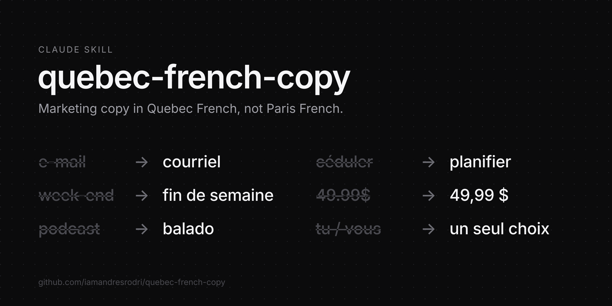
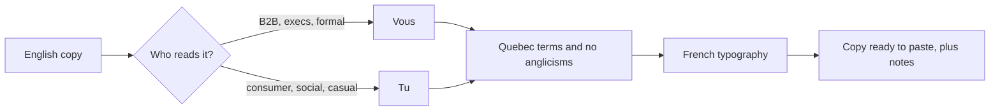

# quebec-french-copy

A Claude skill for marketing copy in **Quebec French**, the kind a Montrealer reads without noticing it started in English.

Most AI translation gives you France French with English sentence structure. In Quebec that reads as translated, and people notice. This skill adapts the copy instead of translating it word for word.

## How it works



## What it handles

| | Instead of | It writes |
|---|---|---|
| Quebec terms | e-mail, week-end, podcast | courriel, fin de semaine, balado |
| Business anglicisms | appliquer sur, céduler, adresser un problème | postuler à, planifier, régler un problème |
| Tu or vous | switching between them | one choice, kept all the way through |
| Typography | 49.99$, "quotes", no spaces | 49,99 $, « guillemets », space before : ; ! ? |
| Length | French that breaks your buttons | a shorter option for headlines, buttons and ads |

## Try it

Once it's installed, ask Claude something like:

> Make a Quebec French version of this landing page. B2B audience.

## Install

**No code (Claude.ai or the Claude app)**
1. Click the green **Code** button at the top of this page, then **Download ZIP**.
2. In Claude, go to **Settings > Capabilities > Skills** and upload the ZIP.
3. Start a new chat and paste the copy you want adapted.

**Claude Code**
```bash
git clone https://github.com/iamandresrodri/quebec-french-copy ~/.claude/skills/quebec-french-copy
```

## What's inside

```
quebec-french-copy/
└── SKILL.md    # Instructions for Claude, including the term lists
```

## Contributing

If you spot a term that's wrong or missing, open an issue. Quebec French changes by industry and region, so I'd rather hear about it.

## License

MIT.

Made by [Andres Rodriguez](https://github.com/iamandresrodri), product marketer in Montreal.
